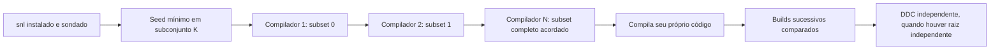
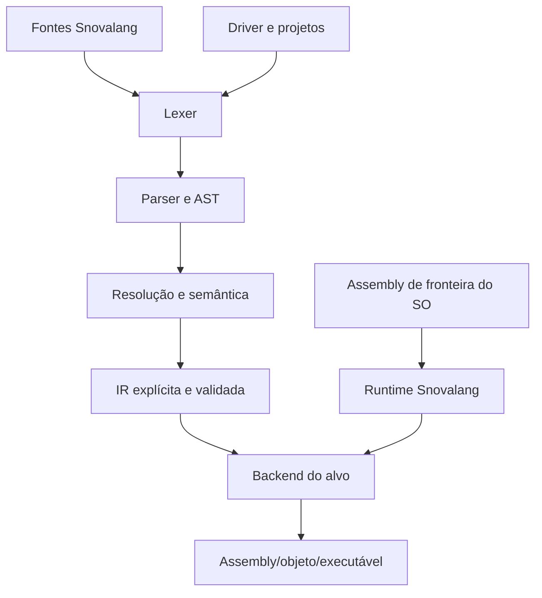

# Visão da arquitetura

## Objetivo

Construir neste repositório um compilador capaz de compilar seu próprio código-fonte, preservando Snovalang como linguagem de implementação. O compilador de referência `../snovac` serve como especificação observável e oráculo durante a migração; não deve ser alterado por este trabalho.

O compilador é a única peça pública de produto. Seu frontend, semântica,
backend, runtime e driver devem ser desenvolvidos em Snova. A raiz `snl`
instalada é temporária; C/C++ não serão uma implementação paralela. O código
atual está em módulos `.snl` importáveis no projeto `bootstrap/src/`, com APIs
públicas pequenas. O `snl build` usa esses módulos diretamente e produz um executável que empacota SnBC com a VM C do `snl` (não é código de máquina do programa; ver ADR-0005). Para se
auto-compilar, o seed ainda monta internamente uma unidade de fonte; resolver
imports entre arquivos arbitrários é o próximo gate de arquitetura. As demais
lacunas estão em `docs/roadmap/subset.md`.

## Estratégia: bootstrap por subconjuntos cumulativos

O seed e o compilador mantêm um subconjunto comum. Cada marco estende a linguagem que o compilador anterior consegue aceitar. O código do compilador só usa recursos já suportados pelo compilador imediatamente anterior. Assim, não há uma fronteira arbitrária entre um dialeto K simples e uma linguagem S que o seed não sabe compilar.

Versões do Mermaid usadas nestes diagramas devem ser suportadas pelo renderizador do GitHub. Os arquivos `.mmd` em `docs/diagrams/` são as fontes editáveis.

## Componentes propostos

- **Seed**: pequeno, auditável, determinístico e limitado ao subconjunto confirmado pela sonda. Gera o próximo compilador; não tenta implementar toda a linguagem.
- **Frontend**: lexer, parser, AST, nomes, tipos e diagnósticos compatíveis com o comportamento de referência documentado.
- **IR**: representação independente do backend, com invariantes e validação explícitas.
- **Backend**: inicialmente um único alvo host. Outros alvos entram apenas após o primeiro caminho vertical estar estável.
- **Runtime**: implementação em Snovalang sempre que possível; assembly apenas para ABI, syscalls e primitivas sem API de linguagem equivalente.
- **Driver**: CLI mínima primeiro; compatibilidade com comandos e flags existentes é expandida por etapas.
- **Conformance harness**: compara resultado do novo compilador com o `snl`/`snovac` de referência sem modificar o checkout de referência.

O layout físico final fica deliberadamente em aberto até o marco de descoberta. A estrutura sugerida é `seed/`, `compiler/`, `runtime/`, `docs/` e `scripts/`, mas os nomes não devem obrigar uma divisão prematura nem duplicar módulos.

## Fronteiras e contratos

1. Cada fase recebe dados explícitos e retorna resultado/diagnósticos; erros não interrompem o processo por exceções antes de existir suporte validado.
2. A serialização/ordenação de símbolos, strings, diagnósticos e artefatos é determinística.
3. Não se adiciona recurso de linguagem sem uma sonda, especificação do subconjunto e casos positivos/negativos.
4. O seed, compilador, runtime e ferramentas de validação têm fronteiras de responsabilidade documentadas.
5. Assembly não vira linguagem de implementação geral: toda função assembly tem contrato de ABI, plataforma, ownership e teste de chamada.

## Definição de self-hosted

Self-hosted significa que uma versão do compilador, construída por um bootstrap identificado, compila as fontes do compilador seguinte. O ponto fixo exige que builds sucessivos tenham artefatos comparáveis e iguais segundo uma política definida. Reprodutibilidade exige builds limpos repetidos com entradas e toolchains registradas. DDC exige uma raiz de confiança independente e é reportado separadamente; dois builds produzidos pela mesma raiz não constituem DDC.

Ver [ADR-0001](../decisions/ADR-0001-incremental-subsets.md), [ADR-0002](../decisions/ADR-0002-evidence-and-fixed-point.md) e o [roadmap](../roadmap/stages.md).
