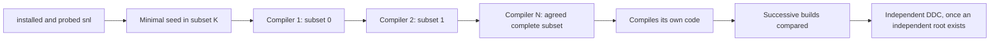
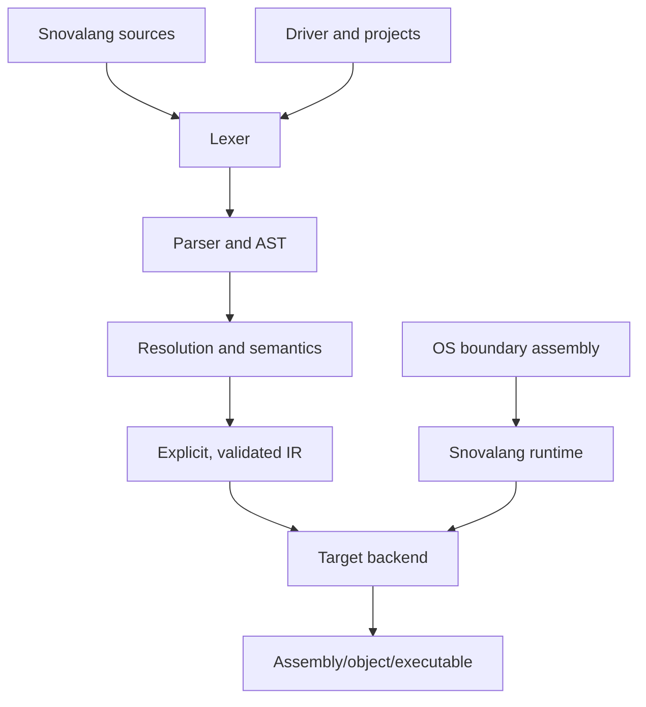

# Architecture overview

## Goal

Build a compiler that compiles its own source code, keeping Snovalang as the implementation language. Reference compiler comparisons are recorded as migration evidence; this repository is the implementation source.

The compiler is the only public product. Its frontend, semantics, backend,
runtime and driver must be developed in Snova. The installed `snl` root is
temporary; C/C++ will not be a parallel implementation. The current code is in
importable `.snl` modules in the `bootstrap/src/` project, with small public
APIs, and the native runtime is in `bootstrap/runtime/`. `snl build` uses
these modules directly and produces an executable that bundles SnBC with the
`snl` C VM (not machine code of the program; see ADR-0005). The native backend
emits aarch64 machine code for the program plus the Snova runtime, linked only
against `libSystem` (ADR-0006). To compile itself, the seed still assembles
one source unit internally; resolving imports between arbitrary files is the
next architecture gate. The remaining gaps are in `docs/roadmap/subset.md`.

The own-root milestone is proposed in
[ADR-0009](../decisions/ADR-0009-committed-snbc-seed.md). Its first slice is a
committed SnBC seed (`bootstrap/seed/`) that compiles the sources through
`snl run-snbc` without `snl check` or `snl build`; it still uses the `snl` C VM
and does not replace the `snl build` CLI.

## Strategy: bootstrap through cumulative subsets

The seed and the compiler share a common subset. Each milestone extends the language that the previous compiler can accept. The compiler source only uses features already supported by the immediately previous compiler. This avoids an arbitrary boundary between a simple dialect K and a language S that the seed cannot compile.

The Mermaid versions used in these diagrams must be supported by the GitHub renderer. The `.mmd` files in `docs/diagrams/` are the editable sources.

## Proposed components

- **Seed**: small, auditable, deterministic and limited to the subset confirmed by probes. It generates the next compiler; it does not try to implement the whole language.
- **Frontend**: lexer, parser, AST, names, types and diagnostics compatible with the documented reference behavior.
- **IR**: a backend-independent representation with explicit invariants and validation.
- **Backend**: initially a single host target. Other targets come only after the first vertical path is stable.
- **Runtime**: implemented in Snovalang whenever possible; assembly only for the ABI, system calls and primitives with no equivalent language API. The native runtime follows this rule: memory, strings, arrays, objects, printing and files are Snova, and assembly is limited to stubs for memory primitives and six libSystem calls (ADR-0006).
- **Driver**: minimal CLI first; compatibility with existing commands and flags grows in stages.
- **Conformance harness**: compares the new compiler's results with the reference `snl`/`snovac` without modifying the reference checkout.

The final physical layout stays deliberately open until the discovery milestone. A suggested structure is `seed/`, `compiler/`, `runtime/`, `docs/` and `scripts/`, but the names must not force a premature split or duplicate modules.

As the frontend grows, replace the joined source unit and parallel state arrays
with typed phase contracts: source files and spans → tokens and syntax trees →
resolved symbols and checked types → validated IR → target artifacts. Keep
each phase's input/output explicit so it can be tested and reused without
sharing mutable compiler-wide state. Classes or structs should own cohesive
state; interfaces should represent behavior that varies at runtime, such as a
target backend; traits and `impl` should express statically checked shared
behavior; generics should preserve concrete input/output types. This is the
direction of travel, not a claim that the current subset already supports all
these mechanisms. See the [maturity assessment](../roadmap/maturity.md) and
[multi-target decision](../decisions/ADR-0008-multi-target-backend.md).

## Boundaries and contracts

1. Each phase receives explicit data and returns results/diagnostics; errors do not stop the process through exceptions before validated support exists.
2. Serialization and ordering of symbols, strings, diagnostics and artifacts are deterministic.
3. No language feature is added without a probe, a subset specification and positive/negative cases.
4. The seed, compiler, runtime and validation tools have documented responsibility boundaries.
5. Assembly does not become a general implementation language: every assembly function has an ABI, platform, ownership and call-test contract.

## Definition of self-hosted

Self-hosted means that a compiler version, built by an identified bootstrap, compiles the sources of the next compiler. A fixed point requires successive builds to produce comparable artifacts that are equal under a defined policy. Reproducibility requires repeated clean builds with recorded inputs and toolchains. DDC requires an independent root of trust and is reported separately; two builds produced by the same root are not DDC.

See [ADR-0001](../decisions/ADR-0001-incremental-subsets.md), [ADR-0002](../decisions/ADR-0002-evidence-and-fixed-point.md) and the [roadmap](../roadmap/stages.md).
